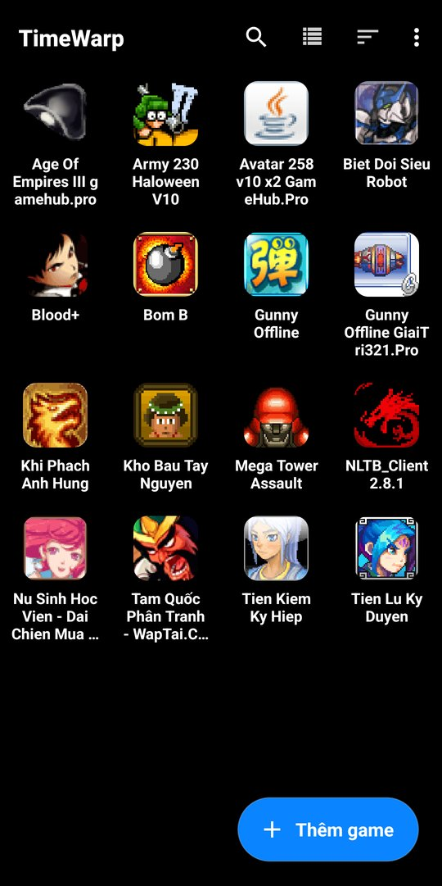
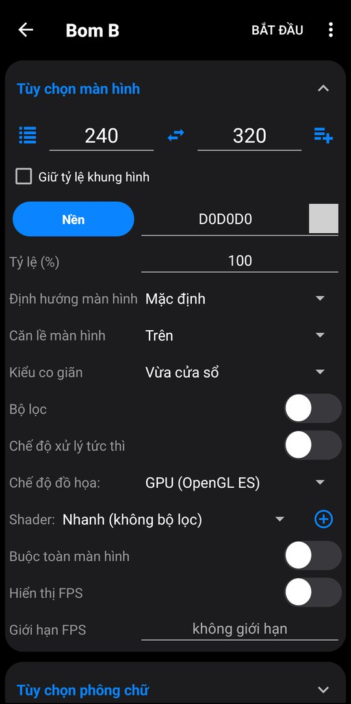
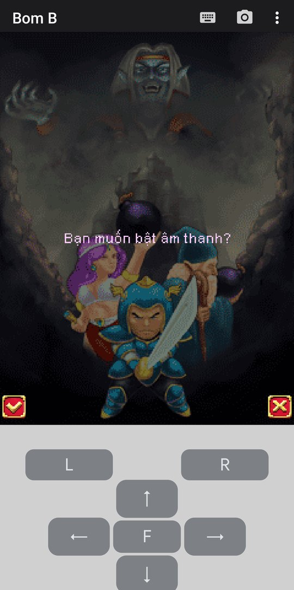
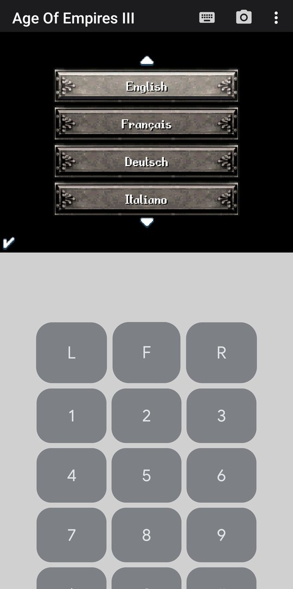

# TimeWarp

Run the apps and games of the old Nokia era on your Android phone.

TimeWarp is an emulator for **J2ME** applications (`.jar` / `.jad`), the format used by Java games on feature phones. It supports most 2D and 3D games, including Mascot Capsule 3D ones, and gives each app its own settings, a configurable on-screen keyboard and scaling.

   

## Download

**[Get the latest signed APK](https://github.com/YCN-AFS/J2ME-Loader/releases/tag/continuous)** (Android 5.0 or newer).

Tagged versions such as `v2.0.0` are listed on the [Releases](https://github.com/YCN-AFS/J2ME-Loader/releases) page. Android will ask you to allow installing apps from your browser or file manager the first time.

Every APK is signed with the same key. You can check it with `apksigner verify --print-certs TimeWarp-*.apk`; the SHA-256 fingerprint is printed in each release's notes.

## Highlights

- Modern interface in light and dark themes, with grouped settings, pill switches and glass-style dialogs (the blur needs Android 12+ and can be turned off).
- **Virtual keyboard** that stays readable, shows pressed keys clearly, and automatically shrinks overlapping keys and centers rows that sit slightly off-center. Your saved layout is never modified by this, and it can be switched off.
- Per-app settings with collapsible sections, plus reusable profiles.
- **Back up and restore:** export everything to a `.zip`, or import an old J2ME-Loader folder straight from the system folder picker.
- Friendly empty screen, search, sorting and a grid or list view.

## Moving from J2ME-Loader

TimeWarp has its own app id, so it installs **next to** J2ME-Loader and does not touch its data.

1. Install TimeWarp.
2. Open **Settings → Import/export data → Import old folder** (or use the button on the empty start screen).
3. Pick your old J2ME-Loader folder, the one that contains `converted`, `data` and `configs`.
4. Check your games, then uninstall J2ME-Loader if you like.

## Tips

- Turning on filtering can greatly reduce performance in some cases. Turn it off if a game is too slow.
- Image flickering can often be fixed by enabling the "Immediate processing mode" option in the app's settings.
- If a game's keyboard layout looks wrong, open the layout editor and use **Auto-fit keys**.

## Compatibility

The J2ME-Loader community keeps lists of tested games; they apply here as well:

- [Tested Java games (touchscreen)](https://github.com/nikita36078/J2ME-Loader/wiki/List-of-Tested-Java-Games-(Touchscreen))
- [Tested Java games (non-touchscreen)](https://github.com/nikita36078/J2ME-Loader/wiki/List-of-Tested-Java-Games-(Non-Touchscreen))
- [Java games with bugs](https://github.com/nikita36078/J2ME-Loader/wiki/List-of-Java-Games-with-Bugs)

## Build from source

You need JDK 21 and the Android SDK.

```
git clone --recurse-submodules https://github.com/YCN-AFS/J2ME-Loader.git
cd J2ME-Loader
./gradlew :app:assemblePlayDebug      # debug APK
./gradlew :app:testPlayDebugUnitTest  # unit tests
```

For a signed release, put your keystore in `app/keystore.jks` and a `keystore.properties` file (with `storeFile`, `storePassword`, `keyAlias`, `keyPassword`) in the project root, then run `./gradlew :app:assemblePlayRelease`, or `:app:bundlePlayRelease` for an Android App Bundle. Both files are ignored by git.

## Tiếng Việt

TimeWarp là trình giả lập ứng dụng và game **J2ME** (`.jar` / `.jad`) cho Android, dành cho những ai nhớ game Java trên điện thoại Nokia đời cũ. App hỗ trợ phần lớn game 2D và 3D, có bàn phím ảo tự khớp, cài đặt riêng cho từng game, sao lưu và khôi phục dữ liệu.

- **Tải về:** [bản APK mới nhất](https://github.com/YCN-AFS/J2ME-Loader/releases/tag/continuous) (Android 5.0 trở lên).
- **Chuyển từ J2ME-Loader:** cài TimeWarp, vào *Cài đặt → Nhập/xuất dữ liệu → Nhập thư mục cũ*, rồi chọn thư mục J2ME-Loader cũ (thư mục chứa `converted`, `data`, `configs`). TimeWarp cài song song nên không ảnh hưởng dữ liệu cũ.

## Credits and license

TimeWarp is based on [J2ME-Loader](https://github.com/nikita36078/J2ME-Loader) by Nikita Shakarun, which is itself a fork of [J2meLoader](https://github.com/NaikSoftware/J2meLoader). Special thanks to [woesss](https://github.com/woesss), author of [JL-Mod](https://github.com/woesss/JL-Mod), for the open-source Mascot Capsule implementation, soundbank support and many other improvements. This project adds a redesigned interface, the keyboard improvements, folder import and other changes on top of that work.

> Copyright 2017-2026 Nikita Shakarun, and the contributors to the changes in this fork.
> Licensed under the [Apache License, Version 2.0](http://www.apache.org/licenses/LICENSE-2.0).
> See the [LICENSE](LICENSE) file for the full license text.
